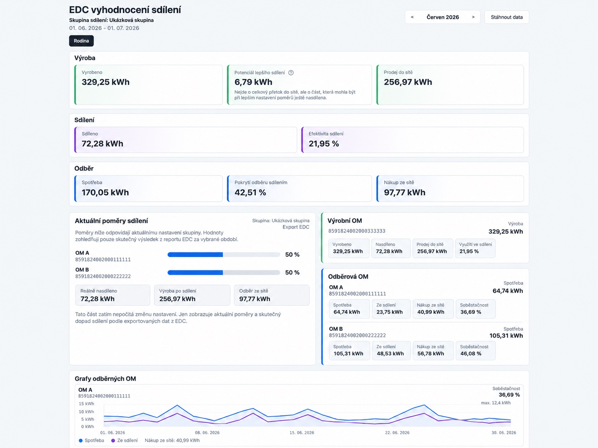
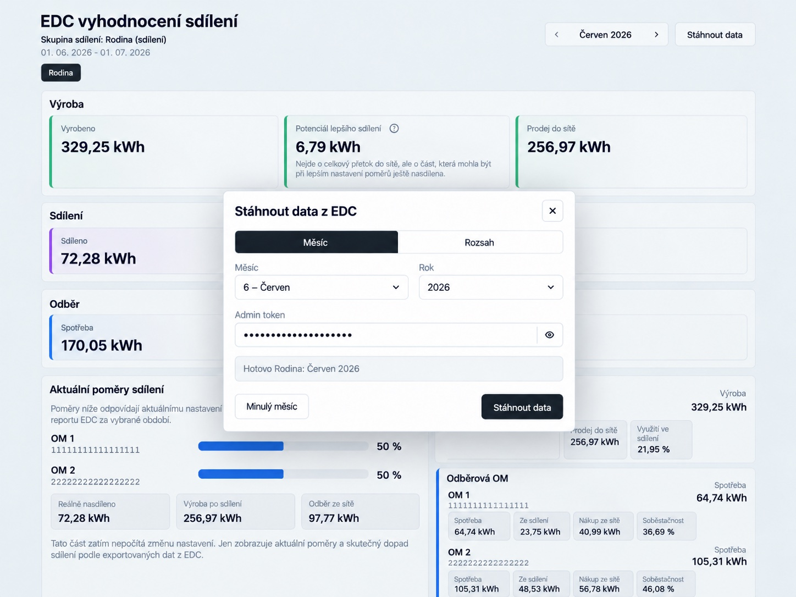

# EDC Sharing Dashboard

EDC Sharing Dashboard is a small self-hosted application for inspecting Czech
EDC electricity-sharing reports. It downloads monthly CSV exports from the EDC
portal, converts interval data into a file-based JSON representation, and shows
production, consumption, sharing performance, and allocation suggestions in a
browser.

The project was built to make EDC exports easier to review without repeatedly
working with raw CSV files. It is a personal prototype rather than an official
EDC client. There is no database and no dependency on a hosted backend.

**Dashboard overview**

Monthly electricity production, consumption, sharing performance, and
allocation analysis.



*Screenshots contain anonymized metering-point identifiers and example data.*

## What It Does

- Downloads EDC reports through headless Chromium and Selenium.
- Supports accounts with multiple sharing groups.
- Parses 15-minute EDC CSV data with `Datum`, `Cas od`, `Cas do`, and paired
  EAN `IN/OUT` columns.
- Stores raw and processed files separately by project and sharing group.
- Shows monthly totals, daily summaries, interval charts, and individual
  production and consumption metering points.
- Compares current allocation ratios with a calculated recommendation based on
  the available interval data.
- Assigns readable local names to EAN metering points.
- Starts downloads from the web UI through a token-protected endpoint.
- Exports a static, read-only copy of the dashboard.
- Runs directly with Python or as a Docker container with Chromium included.

## How It Works

```text
EDC portal
    -> Selenium downloads a monthly CSV report
    -> the parser validates and converts 15-minute measurements
    -> the analyzer writes JSON summaries and allocation recommendations
    -> the Python HTTP server exposes the JSON through a small API
    -> the browser UI renders monthly, daily, and interval views
```

### EDC Report Download

Download monthly EDC reports directly from the dashboard using the built-in
automation workflow.



All runtime state is stored in files:

```text
data/<project-code>/<group-slug>/raw/
data/<project-code>/<group-slug>/processed/
downloads/<project-code>/<group-slug>/debug/
config/om_names.json
```

The recommendation is an exploratory calculation over the imported energy
volumes. For two consumers it evaluates allocation percentages in one-percent
steps; for larger groups it uses a demand-weighted heuristic. It does not model
prices, tariffs, contracts, or regulatory constraints.

## Technology

- Python 3.12 and the standard library for parsing, analysis, JSON storage, the
  CLI, and the HTTP server
- Selenium with Chromium and Chromedriver for EDC portal automation
- Plain HTML, CSS, and JavaScript for the dashboard
- Docker and Docker Compose for a reproducible runtime

## Repository Layout

```text
edc_portal/        Downloader, parser, analyzer, CLI, and HTTP server
web/               Browser UI
config/            Runtime configuration directory for OM display names
tests/             Offline unit tests with synthetic data
Dockerfile         Python, Chromium, and Chromedriver image
docker-compose.yml Local and server runtime configuration
.env.example       Environment configuration template
```

Generated data belongs in `data/`, browser profiles and diagnostics in
`downloads/`, and static exports in `dist/`. These directories are ignored by
Git.

## Quick Start With Docker

Docker is the recommended way to run the project because the image includes a
compatible Chromium and Chromedriver installation.

1. Create your local configuration:

   ```bash
   cp .env.example .env
   ```

2. Fill in the EDC credentials, project code, sharing group, and admin token in
   `.env`.

3. Build and start the application:

   ```bash
   docker compose up -d --build
   ```

4. Open the configured address. With the values from `.env.example`:

   ```text
   http://127.0.0.1:8333/
   ```

Useful lifecycle commands:

```bash
docker compose logs -f
docker compose restart
docker compose down
```

## Environment Configuration

The application reads `.env` directly when running with Python. Docker Compose
also loads it through `env_file`.

```env
EDC_USERNAME=your-edc-login
EDC_PASSWORD=your-edc-password
EDC_PROJECT_CODE=my-project
EDC_GROUP=Exact EDC sharing group name
EDC_ADMIN_TOKEN=replace-with-a-long-random-token

EDC_BIND=127.0.0.1
EDC_PORT=8333
```

| Variable | Purpose |
| --- | --- |
| `EDC_USERNAME` | EDC portal login name. |
| `EDC_PASSWORD` | EDC portal password. |
| `EDC_PROJECT_CODE` | Logical identifier used below `data/` and `downloads/`. |
| `EDC_GROUP` | Exact sharing-group name shown in the EDC portal. |
| `EDC_ADMIN_TOKEN` | Required by the API endpoint that starts a download. |
| `EDC_BIND` | Host interface exposed by Docker Compose. Use `127.0.0.1` behind a reverse proxy. |
| `EDC_PORT` | Host port mapped to the application container. |
| `EDC_CHROME_BINARY` | Optional local path to Chrome or Chromium outside Docker. |
| `EDC_CHROMEDRIVER` | Optional local path to Chromedriver outside Docker. |
| `EDC_CHROME_PROFILE` | Optional persistent browser-profile directory. |
| `EDC_DOWNLOAD_DIR` | Optional override for the raw download directory. |

Never commit `.env`. Credentials, generated reports, browser profiles, and OM
names are intentionally excluded by `.gitignore`.

## Local Python Setup

Python 3.12 is the primary development version. Chromium or Chrome and a
compatible Chromedriver must already be installed when running outside Docker.

```bash
python3 -m venv .venv
.venv/bin/python -m pip install selenium
```

Start the local server:

```bash
.venv/bin/python -m edc_portal.cli serve --host 127.0.0.1 --port 8123
```

Download one or more months:

```bash
.venv/bin/python -m edc_portal.cli download --month 6 --year 2026
.venv/bin/python -m edc_portal.cli download --month 6 7 --year 2026
```

Parse an existing CSV without contacting EDC:

```bash
.venv/bin/python -m edc_portal.cli parse data/my-project/my-group/raw/edc-2026-06.csv
```

Manage local display names for metering points:

```bash
.venv/bin/python -m edc_portal.cli names
.venv/bin/python -m edc_portal.cli set-name 859000000000000000 "Main production"
.venv/bin/python -m edc_portal.cli remove-name 859000000000000000
```

## Static Export

Create a read-only dashboard that can be served by a regular static web server:

```bash
.venv/bin/python -m edc_portal.cli export-static --output dist/example
python3 -m http.server --directory dist/example 8080
```

Opening the generated `index.html` directly through a `file://` URL does not
work because browsers block the JSON requests. Serve the directory over HTTP as
shown above. Static exports cannot download fresh data or save OM names.

## HTTP API

The Python server exposes the web application at `/` and uses these endpoints:

```text
GET  /api/config
GET  /api/groups
GET  /api/months
GET  /api/data/latest
GET  /api/data/month
GET  /api/sync-status
POST /api/sync
GET  /api/om-names
POST /api/om-names
```

`POST /api/sync` requires the token configured in `EDC_ADMIN_TOKEN`. The server
is intentionally small and does not provide user accounts or a full
authorization system.

## Multiple Instances

Separate deployments can share the same image while using different `.env`,
data, download, and configuration directories:

```bash
COMPOSE_PROJECT_NAME=edc-example \
EDC_ENV_FILE=.env.example-local \
EDC_CONTAINER_NAME=edc-example \
EDC_PORT=8334 \
EDC_DATA_DIR=./data/example \
EDC_DOWNLOADS_DIR=./downloads/example \
EDC_CONFIG_DIR=./config/example \
docker compose up -d --build
```

## Server Deployment

Do not expose the repository directory as a public web root. Bind the container
to localhost and place a reverse proxy in front of it:

```env
EDC_BIND=127.0.0.1
EDC_PORT=8333
```

Minimal Nginx example:

```nginx
server {
    listen 80;
    server_name example.com;

    location / {
        proxy_pass http://127.0.0.1:8333;
        proxy_http_version 1.1;
        proxy_set_header Host $host;
        proxy_set_header X-Real-IP $remote_addr;
        proxy_set_header X-Forwarded-For $proxy_add_x_forwarded_for;
        proxy_set_header X-Forwarded-Proto $scheme;
        proxy_read_timeout 300;
    }
}
```

The repository, `.env`, and mounted runtime directories are sufficient for a
Docker deployment. Do not copy `.venv/`, `data/`, `downloads/`, or `dist/`
unless you intentionally want to migrate local state.

## Tests

The offline test suite uses only synthetic data and does not log in to EDC:

```bash
python3 -m unittest discover -s tests -v
```

## Limitations

- This is a personal prototype built around the current EDC portal UI and CSV
  format. Portal changes can break the Selenium workflow.
- Authentication depends on the EDC SSO session behavior. Concurrent or stale
  sessions may require a retry.
- Reports are stored as local files; the project does not provide database
  migrations, multi-user access control, or centralized job scheduling.
- A sharing group or period may legitimately contain no EAN `IN/OUT` columns.
  The application reports this as a no-data period.
- Allocation recommendations are based only on imported kWh values and are not
  operational, financial, or regulatory advice.
- The UI is currently Czech, while developer documentation is English.

## License

This project is available under the [MIT License](LICENSE).
